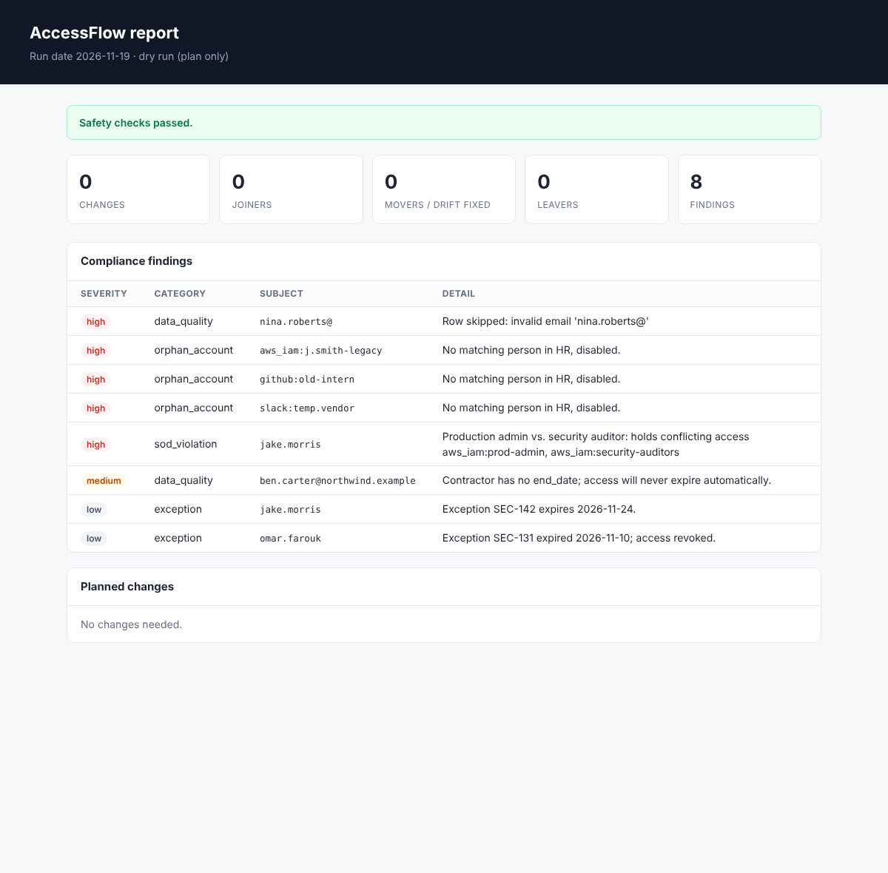

# AccessFlow

A Python tool that keeps employee access in sync with HR data. When someone joins, changes team or leaves, it works out what accounts and groups they should have and updates AWS IAM, GitHub, Slack and Google Workspace to match.



## Why I built this

I wanted a project that solves a real problem every company has, and that relates to the cloud/infrastructure work I want to do.

In most companies, access is handled through IT tickets. Someone joins and waits days for accounts. Someone moves team and keeps their old permissions as well as the new ones. Someone leaves and their login still works weeks later. Over time you also end up with accounts that don't belong to anyone. These problems come up in pretty much every security audit (SOC 2, ISO 27001).

The idea is simple: HR already knows who works where, so access should follow from that automatically.

## How it works

```
HR file (CSV)  ─┐
                ├──> what everyone SHOULD have ──┐
policy.yaml   ──┘                                ├──> compare ──> plan ──> apply ──> audit log
                     what they ACTUALLY have ────┘
                     (AWS, GitHub, Slack, Google)
```

1. Read the HR export and skip any broken rows (they get reported instead).
2. Use `policy.yaml` to work out which groups each person should be in, based on department, job title, location and whether they're a contractor.
3. Get the current accounts from each system.
4. Compare the two and build a list of changes: create account, add to group, remove from group, disable account.
5. Show the plan (`accessflow plan`), or make the changes (`accessflow apply`).
6. Write every change to an audit log.

I based the plan/apply approach on how Terraform works. Running `apply` twice in a row does nothing the second time, because everything already matches.

## What it handles

- **Joiners**: accounts are created 3 days before the start date (configurable)
- **Movers**: new access added, old access removed
- **Leavers**: removed from all groups and disabled on their end date. I disable rather than delete so the account is still there if anyone needs to investigate later
- **Re-hires**: old account re-enabled instead of creating a duplicate
- **Contractors**: a `deny` rule makes sure they never get production access
- **Temporary access**: e.g. someone gets prod-admin for a week. It needs a ticket number and approver, and is removed automatically after the expiry date
- **Conflicting access**: flags people who have two permissions that shouldn't go together (e.g. making payments and approving payments)
- **Orphan accounts**: accounts with no matching person in HR get flagged or disabled
- **Protected accounts**: CI users and emergency admin accounts are never touched

### Safety guard

The thing I was most worried about was a bad HR export. If the CSV gets cut off halfway, it looks like half the company has left, and the tool would happily disable all of them. So if a run would disable more than 25% of accounts in a system, it stops and asks for a human to check (`--force` to override).

### Audit log

Each line in `audit/audit.jsonl` includes the SHA-256 hash of the previous line. If someone edits or deletes an old entry, the chain breaks and `accessflow verify-audit` reports it.

## Running it

```bash
pip install -e ".[dev]"

python scripts/seed_demo.py     # create the demo "before" state
accessflow plan  --hr data/hr_feed.csv --policy config/policy.yaml --today 2026-11-19
accessflow apply --hr data/hr_feed.csv --policy config/policy.yaml --today 2026-11-19
accessflow verify-audit audit/audit.jsonl
```

Or just `make demo`, which runs all of the above and then runs `plan` again to show there's nothing left to change.

The report ends up in `reports/report.html`. There's also `access_review.csv`, which lists everyone's access by manager. The idea is that managers go through it every quarter and confirm their team still needs it.

`--today` is there so the demo always gives the same result. Leave it out to use today's date.

Tests: `make test` (uses moto to fake AWS, so no real account is needed).

## Demo data

`data/hr_feed.csv` is a made-up company with 17 people. I set it up so every scenario above happens at least once: a new starter, someone who changed team, two leavers, a re-hire, a contractor, an expired temporary access, a broken HR row, some leftover accounts nobody owns, and so on.

## Project layout

```
src/accessflow/
  hr.py          reading + validating the HR CSV
  policy.py      loading policy.yaml, working out who gets what
  engine.py      comparing desired vs actual, building the plan, applying it
  audit.py       hash-chained audit log
  report.py      HTML report / CSV / JSON
  cli.py         command line
  connectors/
    base.py        the interface every system has to implement
    aws_iam.py     real AWS IAM (boto3)
    simulated.py   fake Slack/GitHub/Google stored in a JSON file
```

## Using it for real

`.github/workflows/daily-reconcile.yml` is how I'd run it in production: a scheduled GitHub Action that logs into AWS with OIDC (so no AWS keys are stored in GitHub), downloads the HR export from S3, runs `apply`, and uploads the audit log back to S3. It's turned off unless you set `ACCESSFLOW_ENABLED=true`.

`docs/aws-iam-policy.json` has the IAM permissions the tool needs. It can only modify users under the `/accessflow/` path.

## Limitations / what I'd add next

- Slack, GitHub and Google Workspace are **simulated** with a JSON file. AWS IAM is the only real connector. Next steps would be connectors for the GitHub REST API, Slack SCIM and the Google Admin SDK.
- The HR input is a CSV file. A real setup would pull from the HR system's API (Workday, BambooHR etc.).
- No notifications yet. It would be useful to message managers when their report's access changes.
- The audit log is a local file. In production it should go somewhere append-only, like S3 with Object Lock.

## Tech

Python, boto3, PyYAML, Jinja2, Rich, pytest, moto, GitHub Actions, Docker
